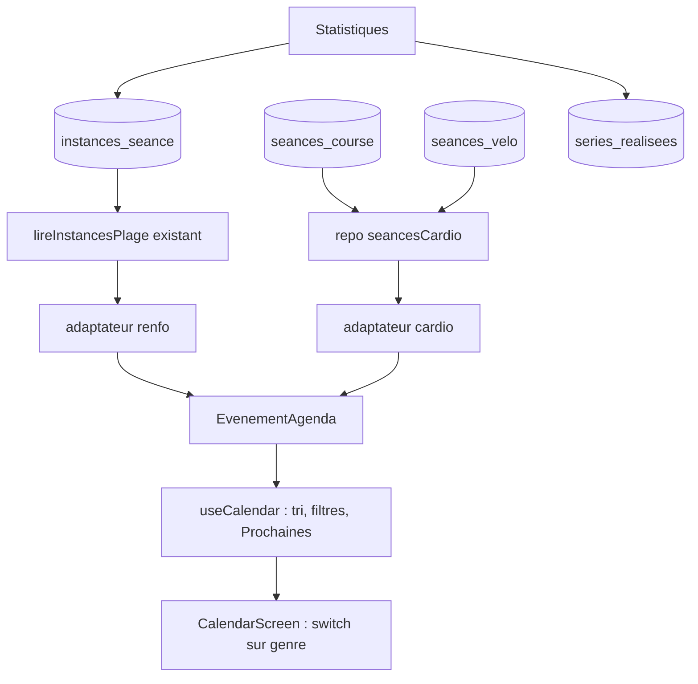

# Séances de cardio dans l'agenda

*   **Author:** Benoît (Maraisopossum), avec Claude
*   **Status:** Implémenté sur la branche `feat/agenda-cardio` (base, accès aux données, agenda, saisie, import, garde-fous, documentation), sans commit ni mise en ligne du client. Spec aligné sur le code le 2026-11-03, garde de l'import comprise ; les écarts avec le plan d'origine sont consignés dans Open Questions.
*   **Date:** 2026-11-03

Convention : sauf mention contraire, les chemins de code sont relatifs à `web/` (par exemple `src/core/sync/connector.ts`).

--------------------------------------------------------------------------------

## Overview

L'agenda de la WebApp PandaMove sait aujourd'hui afficher une seule sorte de séance : le renforcement. Cette conception lui ajoute la course à pied et le vélo, pour que Benoît y place son programme d'endurance et coche chaque séance quand elle est faite.

Ce n'est pas un module cardio. L'agenda ne sert qu'à poser une séance sur un jour, la déplacer et la valider. Les données réelles de la séance (distance, allure, fréquence cardiaque) restent sur Strava, Suunto et MyWoosh. La séance cardio garde seulement un lien vers sa page de statistiques sur l'un de ces services.

Le contexte : le projet Android est abandonné depuis le 2 novembre 2026 ; seule la WebApp est maintenue.

## The Problem

Benoît prépare trois objectifs : le 10 km du Ravensberg (31 janvier 2027), le Pi Marathon en relais (14 mars 2027) et la cyclo Lille-Hardelot (6 juin 2027). Son programme couvre 31 semaines (du 2 novembre 2026 au 6 juin 2027), avec 3 à 4 séances de cardio par semaine, soit 114 séances dans le fichier et 113 une fois le doublon du Ravensberg retiré (la semaine 12 n'a alors plus de séance).

Ce programme vit aujourd'hui dans un fichier HTML autonome, séparé de la WebApp. Benoît y déplace des séances et les coche, mais le calendrier de ce fichier est distinct de l'agenda où il planifie déjà sa musculation, ses gardes et sa récupération. Deux calendriers l'obligent à les croiser à la main, par exemple pour éviter deux séances de jambes intenses consécutives.

L'agenda de la WebApp ne peut pas accueillir ces séances en l'état :
*   il ne lit que `instances_seance`, c'est-à-dire des séances de renforcement liées à un modèle avec blocs, exercices et séries ;
*   les statistiques lisent la même table, donc y ranger du cardio le ferait compter dans le tonnage et la heatmap ;
*   la règle de déplacement existante (une séance terminée ne bouge plus) repose sur une raison qui n'existe pas pour le cardio : sa date ne sert de référence à aucune statistique.

La solution proposée : deux tables synchronisées, `seances_course` et `seances_velo`, qui portent chacune une séance cardio simple (titre, consigne, détail, date, état, lien). L'agenda lit les trois sources, les affiche ensemble et applique à chacune ses propres règles. Un import unique charge les séances du programme 2027, et les suivantes se saisissent une par une.

## Goals

*   **Voir le cardio dans l'agenda.** Les séances de course et de vélo apparaissent dans la grille du mois et dans « Prochaines séances », à côté du renforcement, avec une mention « Course » ou « Vélo » écrite en toutes lettres (jamais la couleur seule).
*   **Poser, déplacer, valider.** Benoît peut ajouter une séance cardio à une date, la déplacer, la valider et la dévalider. Une séance validée ne se déplace pas : il la dévalide d'abord.
*   **Garder le lien vers les statistiques.** Chaque séance peut porter un lien `https://` vers sa page sur Strava, Suunto ou MyWoosh. Un lien invalide n'est jamais cliquable.
*   **Marquer les jalons.** Les courses importantes (Ravensberg, Pi Marathon, Lille-Hardelot) s'affichent avec un drapeau. La mention « optionnelle » s'affiche en toutes lettres et ne change aucun comportement.
*   **Charger le programme 2027 sans doublon.** Un import unique crée les 113 séances du fichier. Le relancer ne duplique rien, n'écrase aucune date déplacée, aucun état validé, et ne recrée aucune séance supprimée.
*   **Laisser les statistiques inchangées.** Une séance cardio validée ne modifie ni le tonnage, ni les séries, ni la heatmap, ni le compteur de séances terminées. Un test garde cette règle.
*   **Rester synchronisé et isolé par compte.** Les deux tables se synchronisent sur les appareils de Benoît ; un autre compte ne les lit ni ne les écrit (RLS, vérifiée par `rls-live.spec.ts`) ; les suppressions sont logiques. Le déploiement, exécuté dans l'ordre décrit, n'interrompt pas la synchronisation du renforcement.
*   **Un seul module d'accès aux données pour les deux tables.** `seancesCardio.ts` sert les deux tables, sans copie du code par genre.

## Non-Goals

*   Un module cardio : pas d'écran dédié, pas de route ni d'entrée dans la navigation, pas de dossier `features/cardio/`.
*   Une exécution guidée, un chronomètre, un suivi GPS, un import FIT ou GPX, la saisie de résultats (durée réelle, distance, allure, fréquence cardiaque).
*   L'intégration du cardio aux statistiques, « pour le moment ». Si cela change plus tard, la date d'une séance validée devra devenir une référence, et la règle de déplacement sera à revoir.
*   Les séances de musculation et les routines du fichier HTML.
*   Le cardio dans l'export JSON de sauvegarde. La source du programme est le fichier HTML ; une ligne du [README](../../../web/README.md) le documente. Conséquence acceptée : les séances saisies à la main n'ont pas d'autre sauvegarde que la base synchronisée ; seules les séances importées peuvent être recréées depuis le fichier HTML.
*   Une liste blanche de domaines pour le lien, un décompte « J-X » avant un jalon, un filtre par jalon, une table `jalons`.
*   Des colonnes ou tables « pour plus tard » (distance, allure, fréquence cardiaque, `valide_at`, abstraction « workout » générique). Les deux tables sont conçues pour pouvoir migrer vers la future table `workouts` du [spec de la phase 1](./2026-10-24-pandafit-webapp-phase1-design.md) ; elles ne l'anticipent pas.
*   La compatibilité avec l'application Android.

## Open Questions

*   **Test de bout en bout non exécuté.** `e2e/cardio-agenda.spec.ts` est écrit et reconnu par Playwright, mais n'a pas tourné faute de compte de test ; ses sélecteurs peuvent demander un ajustement au premier passage.
*   **Décisions prises à l'écriture du code** (elles étaient ouvertes à l'issue de la revue, arrêtée sur du churn après deux tours : 0 bloquant, 28 majeurs). Emplacement du bouton d'import : onglet « Programme 2027 » de l'écran Import. Seul `creer` accepte une transaction appelante (`Db | DbTx`) ; `modifier`, `deplacer`, `definirValidation` et `supprimer` ouvrent la leur et relisent l'état dedans. L'identifiant déterministe est passé à `creer` dans la saisie (`id`). `lienValide` renvoie `{ ok: true, valeur }` (forme normalisée, ou `null` pour un lien vide) ou `{ ok: false, raison }`. Un déplacement refusé s'annonce avant l'ouverture du dialogue de date. Le jour de la grille porte un nom accessible qui cite genre et titre des séances de cardio. `strength/useSeanceList.test.ts` a été modifié (cas de `dateIsoValide` déplacés). Les textes d'erreur cités dans ce document sont ceux du code. Les rapports de revue détaillés sont dans le dossier de travail (`zoom_out_report.md`, `comprehension_report.md`, `critic_report*.md`, `intermediate_zoom_out_report.md`, `implementation_readiness_report*.md`, `goldfish_review_report*.md`).
*   **Décisions d'architecture encore contestées par la revue.** L'étape 8 (`egm-zoom-out-8-2`, `-8-3`) propose un script d'import hors de l'application (insertion directe dans Supabase) et une seule table `seances_cardio` avec une colonne `sport`. Le document retient l'import dans l'application et deux tables, par choix de Benoît. Cette décision n'a pas été rouverte.
*   **Accueil sans renforcement.** L'accueil compte seulement `instances_seance` : un utilisateur qui n'a que du cardio verrait l'état vide. Hors périmètre de ce chantier, à traiter si besoin.

## Critical User Journeys (CUJs)

### CUJ 1 : Charger le programme 2027
Benoît ouvre l'application sur un seul appareil, attend la première synchronisation, puis ouvre l'écran Import et touche « Importer le programme 2027 ». Le résultat indique « 113 séances ajoutées ». Les séances apparaissent dans l'agenda avec leur pastille « Course » ou « Vélo », les drapeaux sur les trois jalons et la mention « Optionnelle » là où elle s'applique. Il relance l'import par erreur : le résultat indique « Aucune séance ajoutée : 113 déjà présentes » et rien ne change.

### CUJ 2 : Suivre sa semaine
Benoît ouvre l'agenda. Dans « Prochaines séances », il voit ses 10 prochaines séances, renforcement et cardio mélangés par date. Il ouvre le mois et trouve ses séances de course ou de vélo à côté de ses séances de renforcement et de ses gardes, ce qui lui permet d'éviter deux séances de jambes intenses consécutives.

### CUJ 3 : Déplacer une séance
Un jour de garde empêche la séance de jeudi. Benoît la déplace au vendredi avec le dialogue de date. Si la séance est déjà validée, l'application répond « Dévalidez la séance pour la déplacer » dès le clic sur « Changer la date », sans ouvrir le dialogue ; il la dévalide, la déplace, puis la valide à nouveau.

### CUJ 4 : Valider et garder la trace
Après sa sortie, Benoît touche « Valider » sur la séance. Elle passe à « Validée » et sort de « Prochaines ». Il colle ensuite le lien de la séance sur Strava, Suunto ou MyWoosh. Le lien s'ouvre dans un nouvel onglet. Un lien qui n'est pas en `https://` est refusé à la saisie.

### CUJ 5 : Ajouter une séance à la main
Benoît sélectionne un jour, touche « Ajouter une séance de cardio », choisit course ou vélo, saisit le titre, la consigne et le détail (par exemple « 45 min · Z2 »), et enregistre. La séance apparaît dans l'agenda sur tous ses appareils.

## Technical Plan (Architecture)

### Décision d'architecture : une union pour l'agenda

L'agenda manipule un seul type, `EvenementAgenda`, qui porte un champ `genre` valant `renfo`, `course` ou `velo`. Les séances de renforcement sont converties par un adaptateur à partir de `InstanceVue`, qui reste inchangé : les onze fichiers de `strength` qui l'importent ne bougent pas. Les séances de course et de vélo sont converties par un second adaptateur. Tout le code de l'agenda (tri, filtres, « Prochaines séances », grille) travaille sur `EvenementAgenda` et traite chaque genre avec un `switch` exhaustif : ajouter un genre fait échouer la compilation partout où il manque.

Raison : l'agenda reste ouvert à d'autres genres sans réécriture. Coût : deux adaptateurs et des `switch` exhaustifs dès aujourd'hui, au lieu d'un champ de plus dans `InstanceVue`. Un futur module (course, vélo ou autre) ajoute un adaptateur et une branche de `switch` ; sa seule modification visible dans l'agenda est la cible du clic, la feuille d'édition simple étant remplacée par la route du module. Le raisonnement face aux autres options (B, C, D) figure dans Alternatives Considered.

Limite connue : voir Risks & Mitigations.

### Vue d'ensemble

Les statistiques lisent seulement `instances_seance` et `series_realisees`. Elles ne touchent jamais les deux nouvelles tables : l'exclusion du cardio vient de la structure, pas d'un filtre. Deux tests gardent cette règle : un test comportemental valide une séance cardio et vérifie que le tonnage, les séries, la heatmap et le compteur de séances terminées ne changent pas ; un test textuel échoue si une source de `src/features/stats`, de `src/features/demarrage` ou de `src/features/home` mentionne `seances_course` ou `seances_velo`. `schema.ts`, le module d'accès aux données cardio, l'import et les parcours de purge ne sont pas concernés par ce test.

### Stockage

Deux tables de même forme, `seances_course` et `seances_velo`. Colonnes :

*   `id` : UUID. Pour les séances importées, UUID v5 déterministe (namespace = identifiant de l'utilisateur, nom = `programme2027|` suivi de la clé `cle` de l'entrée, sans la date, pour qu'une séance déplacée garde son identité). Pour les séances saisies à la main, UUID aléatoire.
*   `user_id`, `created_at`, `updated_at`, `deleted_at` : les colonnes communes déjà utilisées par les autres tables synchronisées.
*   `titre` (obligatoire), `consigne`, `detail` (texte, facultatifs). `detail` reprend tel quel le texte « durée · zone » du fichier source (par exemple « 45 min · Z2 », « 10 km · endurance fondamentale ») ; il n'est pas découpé (décision du 2026-11-03).
*   `date` : jour au format `yyyy-MM-dd`, obligatoire.
*   `optionnelle` : booléen (entier 0/1 côté PowerSync). Affichage seulement.
*   `jalon` : texte facultatif. Non vide = séance-jalon, affichée avec un drapeau, son texte est le libellé.
*   `lien` : texte facultatif. Contrainte SQL : vide ou commençant par `https://`.
*   `is_validated` : booléen, même convention que `is_completed` de `instances_seance`. Pas de date de validation.

Contraintes SQL :

*   `date` correspond au format `yyyy-MM-dd` (expression régulière) ;
*   `titre` : 1 à 200 caractères ;
*   `consigne` : au plus 2000 ; `detail` : au plus 100 ; `jalon` : au plus 100 ;
*   `lien` : au plus 2048.

Un rejet de contrainte (`23514`) est classé définitif par le connecteur : la ligne reste visible localement jusqu'à la synchronisation suivante, puis disparaît ; seule l'alerte `rejetsEnvoi` la signale. La saisie manuelle et l'import valident donc d'abord les mêmes règles côté client (date réelle via `dateIsoValide`, longueurs, `lienValide`) ; la contrainte SQL est une seconde vérification.

Index : `(user_id, date)` partiel sur `deleted_at is null`, pour la lecture d'un mois et des « Prochaines ».

Sécurité, copiée de la migration 0006 : droits retirés à `anon`/`authenticated` puis `select, insert, update` accordés à `authenticated` (pas de `delete`), une politique RLS `<table>_proprietaire` basée sur `user_id = (select auth.uid())`, le déclencheur `set_updated_at`. Les suppressions sont logiques (`deleted_at`). Droit de réplication : le `grant select on all tables in schema public` du déploiement initial ne couvre que les tables existantes à son exécution ; la migration accorde donc explicitement `select` sur `seances_course` et `seances_velo` à `powersync_role` (guide Supabase + PowerSync, développement) et à tout rôle `powersync_<suffixe>` portant l'attribut de réplication (PowerSync Cloud génère un nom propre au compte ; en production : `powersync_139f8681431505f8ca4df3c4`, relevé le 2026-11-03). Aucun autre rôle n'est concerné. Publication : si la publication `powersync` liste ses tables (cas de la production, observé le 2026-11-03), la migration y ajoute les deux tables qui n'en sont pas déjà membres ; une publication « toutes les tables » (développement) n'est pas touchée.

### Synchronisation et ordre de déploiement

Le connecteur de synchronisation traite une table inconnue comme une erreur à réessayer, sans fin. Un client qui écrit dans `seances_course` avant que la table existe bloquerait toute la file d'envoi, renforcement compris. L'ordre est donc imposé :

1.  Migration SQL `0008_seances_cardio.sql` appliquée sur Supabase (idempotente, dans une transaction). Vérifier que PostgREST voit les tables (une lecture REST de `seances_course` renvoie une liste vide, pas `PGRST205`).
2.  Lire les messages `NOTICE` de la migration (aucun rôle de réplication trouvé, publication absente, droits insuffisants) et, le cas échéant, faire à la main ce qu'ils indiquent. Vérifier ensuite que `pg_publication_tables` contient les deux tables et que le rôle de réplication réel (en production `powersync_139f8681431505f8ca4df3c4`) a `select` sur les deux, via `has_table_privilege`.
3.  Règles de synchronisation PowerSync mises à jour (fichier `sync-rules.yaml`, aussi collé à la main dans le tableau de bord PowerSync Cloud).
4.  Nouveau client déployé.

Retour arrière : redéployer l'ancien client. Les tables restent en place, inertes. Pas de `drop table`.

Décision : `connector.ts` n'est pas modifié. Tolérer une table absente (`PGRST205` ou `42P01`) ferait abandonner en silence les écritures cardio faites avant la migration ; la file de renforcement est protégée par l'ordre de déploiement, appliqué par une seule personne sur un seul compte. Risque résiduel : un client cardio exécuté avant la migration (environnement de développement, mauvais ordre) ou pendant le délai de rechargement du cache de schéma PostgREST après la migration (`PGRST205` transitoire) bloque sa file d'envoi, renforcement compris, jusqu'à ce que la table soit visible. Un ancien client n'est pas concerné : il n'écrit jamais dans les nouvelles tables.

Listes de tables maintenues à la main, à mettre à jour dans ce chantier :

*   `powersync/sync-rules.yaml` (aussi collé dans le tableau de bord PowerSync Cloud) ;
*   `src/core/db/schema.ts` ;
*   `powersync/sync-rules.test.ts` ;
*   `supabase/tests/schema-rls.test.ts` ;
*   `e2e/rls-live.spec.ts`.

Un test de cohérence vérifie que `schema.ts`, la migration et `sync-rules.yaml` citent les mêmes tables. `src/core/sync/connector.ts` n'en fait pas partie (voir la décision ci-dessus).

### Accès aux données

Un module d'accès aux données partagé `core/db/repos/seancesCardio.ts`, avec une liste blanche `TABLES_CARDIO = { course: 'seances_course', velo: 'seances_velo' }`. Chaque fonction reçoit le genre, jamais un nom de table libre : le nom de table interpolé dans le SQL vient toujours de cette liste. Fonctions : lire une plage de dates, lire les prochaines, créer, modifier, déplacer, valider/dévalider, supprimer (suppression logique), lire une séance par identifiant en incluant les supprimées (pour l'import). `deplacer` et `definirValidation` relisent la ligne dans la même transaction d'écriture et exigent `deleted_at is null` ; `deplacer` refuse une séance validée, comme `deplacerInstance` pour le renforcement. Une validation arrivée d'un autre appareil entre l'affichage et le déplacement est donc détectée à l'écriture.

### Modèle de l'agenda

*   `EvenementAgenda` : champs communs (identifiant, genre, date, titre, état) et, selon le genre, les champs propres (renforcement : les informations déjà affichées ; cardio : consigne, détail, optionnelle, jalon, lien).
*   États : une séance cardio validée prend l'état `terminee`, non validée l'état `planifiee`. Le filtre existant (toutes / programmées / terminées) s'applique sans changement. L'état `en_cours` n'existe que pour le renforcement.
*   `peutDeplacer(evenement)` : fonction pure. Faux pour une séance terminée, quel que soit le genre. Le message d'erreur dépend du genre : pour le cardio, « Dévalidez la séance pour la déplacer ». Cette règle est identique à celle du renforcement et conservée par cohérence d'interface (décision du 2 novembre 2026). Coût : trois gestes pour déplacer une séance validée (dévalider, déplacer, valider ; CUJ 3).
*   « Prochaines séances » : chaque source renvoie ses 10 prochaines (hors séances terminées), puis les listes sont fusionnées, triées par `(date, genre, id)` (genre dans l'ordre renforcement, course, vélo, comme dans la grille), puis limitées à 10.
*   Lecture : les trois sources sont lues en une seule passe de `useCalendar`, protégée par la même séquence « dernier appel gagne » que les lectures actuelles. Les trois lectures ne forment pas une transaction ; une écriture entre deux lectures peut afficher une séance en double ou manquante jusqu'à la relecture qui suit chaque action. Voir Risks & Mitigations.
*   Grille et liste du jour : ordre stable par genre (renforcement, course, vélo), puis par `id`. Le renforcement passe donc toujours avant le cardio dans une journée.

### Interface

*   Ligne cardio dans la liste : titre, pastille de texte « Course » ou « Vélo » (couleur du module Calendrier), drapeau et libellé pour un jalon, pastille « Optionnelle » en toutes lettres, lien « Statistiques » s'il est valide.
*   Règles d'accessibilité : voir Non-Functional Requirements.
*   Lien : validé à l'écriture et à l'affichage par une fonction pure `lienValide` (adresse bien formée, schéma `https:` uniquement, pas d'identifiants dans l'adresse, espaces retirés, longueur maximale). Un lien invalide s'affiche en texte brut. Un lien valide s'ouvre dans un nouvel onglet avec `rel="noopener noreferrer"`.
*   Saisie minimale : bouton d'ajout depuis le jour sélectionné (genre, titre, consigne, détail, jalon, optionnelle, lien), feuille d'édition au clic, Valider/Dévalider, suppression logique avec confirmation. Le déplacement réutilise la boîte de dialogue de date existante, ouverte par « Changer la date » ; pour une séance validée, le message de refus s'affiche à la place et le dialogue ne s'ouvre pas. Pas de glisser-déposer.
*   Aucune route, aucun dossier `features/cardio/`, aucune entrée dans la navigation. Le code vit dans `features/calendar/seancesCardio/`.

### Dépendances entre modules

`calendrier.ts` importait `dateIsoValide` depuis `strength/affectation`, alors que onze fichiers de `strength` importent le calendrier. `dateIsoValide` passe dans un module neutre, `core/common/dates.ts` (fait) : `calendrier.ts` et le module d'accès aux données cardio l'importent de là, et `strength/affectation.ts` la ré-exporte pour que les fichiers de `strength` qui l'importent restent inchangés. Ce déplacement ne supprimait pas tout le cycle : `DateDialog` et `SupprimerInstanceDialog` importaient encore `usePiegeFocus` depuis `strength`. Décision du 2026-11-03 : `usePiegeFocus` et `verrouDefilement` (avec leurs tests) passent dans `core/ui/`, et `strength/usePiegeFocus.ts` devient un relais d'une ligne, pour que les fichiers de `strength` qui l'importent restent inchangés. Plus aucun fichier de `features/calendar` (tests compris) n'importe `strength` ; `calendar/independanceStrength.test.ts` garde cette règle. Le dialogue d'édition (fichier 23) importe le hook depuis `core/ui`. `ErreurCalendrier`, la grille et la boîte de dialogue de date restent dans `features/calendar/`, où vit aussi le code cardio.

### Import du programme 2027

Fichier source : `Programme_endurance_PandaMove_2027_Zwift_KICKR.html`, copié dans `support/` à la racine du dépôt (hors de `web/`). Il contient un littéral `const weeks=[…]` : une liste de semaines `{n, start, end, label, events}`, où chaque événement est un tableau `[date, type, titre, "durée · zone", consigne, optionnelle?]` (`type` vaut `run` ou `bike`, le 6e élément est facultatif). Le littéral se termine au repère `;` suivi d'un saut de ligne (`\n` ou `\r\n`) et de `const strengthA` (`\n` dans la copie actuelle). L'entrée du 24 janvier (semaine 12) est un doublon du Ravensberg du 31 janvier, seul conservé ; c'est le seul événement de la semaine 12, qui devient vide. Le littéral est du JSON valide (vérifié le 2026-11-03 sur cette copie : 31 semaines, 114 événements dont 64 de course et 50 de vélo, dates du 3 novembre 2026 au 6 juin 2027). Le script échoue sans rien écrire sur tout format inattendu (repère absent, échec de `JSON.parse`, clé ou type inconnu).

1.  Un script Node ponctuel lit le fichier HTML, extrait le littéral entre `const weeks=` et le repère de fin, l'analyse avec `JSON.parse` (jamais `eval`) et écrit un fichier JSON versionné dans le dépôt Git.
2.  Règles de conversion :
    *   `detail` reprend le texte « durée · zone » du fichier source sans le couper ;
    *   `jalon` est déduit du titre (RAVENSBERG, Pi Marathon, LILLE-HARDELOT de type vélo) ; sur la copie actuelle, la règle repère 4 jalons avant le retrait du doublon et 3 après ;
    *   `optionnelle` est vrai si le 6e élément du tableau est vrai ou si la consigne contient « facultatif » ou « optionnel » ; sur la copie actuelle, 7 séances (1 par le 6e élément, 6 par la consigne) ;
    *   le script écrit pour chaque entrée une clé `cle` = `w{semaine}|e{rang}`, où `rang` est la position de l'entrée dans la semaine du fichier source brut, calculée avant tout retrait ; le JSON versionné contient cette clé et l'import ne la recalcule jamais ;
    *   l'entrée du 24 janvier est retirée après le calcul des clés, donc les autres clés de la semaine 12 ne bougent pas ;
    *   le programme 2027 est figé : une correction du fichier source passe par une nouvelle entrée avec une nouvelle clé, jamais par un décalage de rangs.
3.  Un bouton de l'application, « Importer le programme 2027 » (onglet « Programme 2027 » de l'écran Import), insère le JSON en une seule transaction d'écriture : tout ou rien. Il est actif seulement quand la première synchronisation de l'appareil est terminée (`db.waitForFirstSync`), que l'état de synchronisation est « en ligne » (ni « hors ligne » ni « synchronisation en cours »), et que la file d'envoi locale est vide (`getUploadQueueStats().count === 0`, relue à chaque changement d'état). La file est relue une dernière fois au clic : une écriture apparue entre-temps annule l'import avec un message. Tant que le bouton est inactif, la raison s'affiche sous lui. Une file illisible bloque l'import (erreur journalisée). Ces conditions ne prouvent pas qu'un autre appareil a fini d'envoyer. Risque résiduel, accepté : un autre appareil resté hors ligne avec des modifications non envoyées (séance déplacée, validée ou supprimée) peut voir ces modifications écrasées par l'import. L'import se lance donc une seule fois, sur l'appareil à jour, avant toute autre modification du programme.
4.  Rejouable : pour chaque séance, l'application lit la ligne même supprimée logiquement. Si elle existe, elle est ignorée : une date déplacée, un état validé ou une suppression ne sont jamais écrasés. Le résultat affiche le nombre de séances ajoutées et déjà présentes. Une entrée invalide fait échouer toute la transaction (message générique « L'import a échoué, aucune donnée n'a été modifiée. », détail dans la console) ; elle ne peut pas arriver avec le JSON versionné, que `programme2027.test.ts` fait passer par la même validation que la saisie. Les jalons et les séances optionnelles sont contrôlés par ce test sur le fichier versionné, pas par un rapport affiché à l'écran.
5.  Les dates sont traitées en date locale, jamais avec `new Date('yyyy-MM-dd')`.
6.  Le module d'import existant (`core/import`, format Android v3.2) n'est pas réutilisé.

## Alternatives Considered

Critère appliqué : un coût de structure est accepté s'il se traduit par du code ou des colonnes utilisés dès aujourd'hui, et refusé s'il ajoute des colonnes ou une couche sans usage. L'union et les deux tables n'ajoutent que du code utilisé dès aujourd'hui (adaptateurs, définitions, règles) ; l'abstraction « workout » et les colonnes réservées ajouteraient des colonnes et une couche sans usage. Garder deux tables garde en plus une option pour un futur module : c'est un pari sans besoin présent, dont le surcoût est chiffré ci-dessous.

### Stockage

*   **Une seule table cardio avec une colonne `sport`.** Même résultat à l'écran, avec une migration, un schéma PowerSync, une politique RLS et un module de lecture en moins. Écartée. Surcoût de deux tables : une migration (une boucle sur deux noms), deux définitions dans `schema.ts` via un objet de colonnes partagé, deux entrées dans `sync-rules.yaml`, une liste blanche de deux noms, un test de cohérence en plus. Aucun code n'est dupliqué : le module d'accès aux données est partagé. Contrepartie : chaque genre pourra évoluer (colonnes, module dédié) sans migrer l'autre.
*   **Réutiliser `instances_seance` avec un modèle de séance vide.** Une instance est liée à un modèle avec blocs et exercices, et les statistiques lisent cette table : le cardio y serait compté dans le tonnage et la heatmap.
*   **Une vue SQL `UNION` des deux tables.** Une publication Postgres ne contient que des tables, donc PowerSync ne peut pas synchroniser une vue. L'union se fait côté client, avec une requête par source.
*   **Un champ `type` générique ou une abstraction « workout ».** Aucun besoin actuel ne le justifie. Le [spec de la phase 1](./2026-10-24-pandafit-webapp-phase1-design.md) prévoit déjà une future table `workouts`, vers laquelle les deux tables restent migrables.
*   **Une table `jalons`, ou une contrainte fermée sur le jalon.** Chaque nouvelle course demanderait une migration. Un texte libre facultatif suffit.
*   **Deux colonnes `duree` et `zone`.** Écartée le 2026-11-03. Sur les 114 lignes du fichier source, le texte après « · » prend 25 valeurs distinctes dont 17 ne sont pas des zones (`2 × 8 min Z3`, `objectif 1 h 10`, `6 juin 2027`), et le texte avant contient `10 km`, `14,065 km` et `Randonnée cyclo` pour les jalons. Une colonne unique `detail` évite une règle de découpage qui donnerait des noms de colonnes faux.
*   **Une liste blanche de domaines pour le lien.** La liste demande une mise à jour à chaque nouveau service de statistiques. La limite à `https://` suffit.
*   **`drop table` comme retour arrière.** Un client déjà déployé continuerait d'écrire dans ces tables (voir Synchronisation et ordre de déploiement).

### Agenda

*   **Une union `EvenementAgenda` avec un adaptateur par source (option A, retenue).** Voir Décision d'architecture.
*   **Étendre `InstanceVue` avec des champs facultatifs (option B).** Aucun adaptateur à écrire aujourd'hui, mais `seanceId` est obligatoire et le type finit par porter des champs sans sens pour le cardio. Avec un module course et un module vélo, il faudrait le refaire en union, en modifiant aussi les onze fichiers de `strength` qui importent `InstanceVue`.
*   **Deux listes parallèles, sans type commun (option C).** Ne modifie ni `InstanceVue` ni les fichiers de `strength`, mais le tri, les filtres et « Prochaines séances » sont écrits une fois par source, soit trois fois, et « Prochaines séances » fusionne dans l'écran des listes de types différents. Chaque nouvelle source ajoute un tableau et une sous-liste.
*   **Un `features/cardio/` avec entrée dans `app/modules.ts` (option D).** Contredit le Non-Goal « Un module cardio ». Le code vit dans un sous-dossier de l'agenda.

### Import

*   **Un sélecteur de fichier `.html` dans la PWA.** Le fichier est un littéral JavaScript dans du HTML : il faudrait embarquer un analyseur dans l'application pour un import qui ne s'exécute qu'une fois. Écartée. L'option retenue est un script Node ponctuel qui produit un JSON versionné.
*   **Un seed SQL côté Supabase.** Contourne PowerSync et oblige à recalculer les identifiants en SQL.
*   **Réutiliser `core/import` (format JSON v3.2).** Format Android, listes de tables fermées.

### Synchronisation

*   **Tolérer une table absente dans le connecteur (`PGRST205`, `42P01`).** Le renforcement continuerait de se synchroniser même si un client part avant la migration. Écartée : une écriture cardio faite avant la migration serait abandonnée en silence, et la séance saisie dans l'intervalle serait perdue. Le déploiement est fait par une seule personne, dans l'ordre décrit.

## Risks & Mitigations

| Risque | Mitigation | Statut |
| :--- | :--- | :--- |
| Un client cardio exécuté avant la migration (ou avant le rechargement du cache PostgREST) bloque la file d'envoi, renforcement compris. | Ordre de déploiement : migration, publication, règles PowerSync, client. `connector.ts` inchangé. | Accepté. |
| La publication PowerSync de production ne contient pas les nouvelles tables : rien ne se réplique, sans erreur visible. | La production liste ses tables (observé le 2026-11-03) : la migration ajoute les deux tables ; vérification via `pg_publication_tables` avant les règles et le client. | À vérifier. |
| Le rôle de réplication PowerSync ne peut pas lire les nouvelles tables : rien ne se réplique, sans erreur visible. | La migration accorde `select` à `powersync_role` et aux rôles `powersync_<suffixe>` avec réplication (production : `powersync_139f8681431505f8ca4df3c4`) ; vérification par `has_table_privilege`. | À vérifier. |
| L'import écrase des modifications d'un autre appareil resté hors ligne. | Bouton actif après la première synchronisation, en ligne et file d'envoi vide (relue au clic) ; import unique sur l'appareil à jour. | Accepté. |
| Les identités des séances importées se décalent si le fichier source change. | Clé `cle` calculée sur le fichier brut et écrite dans le JSON versionné ; programme figé. | Traité. |
| Les séances saisies à la main n'ont aucune sauvegarde hors de la base synchronisée. | Aucune : le cardio est hors de l'export JSON. | Accepté. |
| Validation et dévalidation simultanées sur deux appareils : le dernier envoi gagne, sans signal de conflit. | Aucune. | Accepté. |
| Une validation arrivée d'un autre appareil pendant un déplacement. | Relecture de l'état dans la transaction d'écriture. | Traité. |
| Un rejet de contrainte SQL (`23514`) fait disparaître la ligne après coup. | Validation côté client d'abord ; l'alerte `rejetsEnvoi` signale le rejet. | Accepté. |
| Les trois lectures de l'agenda ne sont pas atomiques : une séance peut apparaître en double ou manquer un instant. | Relecture après chaque action, séquence « dernier appel gagne ». | Accepté. |
| Volume : 113 lignes importées ; l'import tient en une transaction et chaque lecture « Prochaines » est limitée à 10 par source. | Voir NFR Performance. | Accepté. |
| L'adaptateur de l'agenda doit rester à jour quand une source gagne un champ affiché. | Il ne lit que les colonnes d'affichage, jamais les données riches d'un futur module ; l'union fait échouer la compilation si un genre manque. | Traité. |

Statuts : Traité = une mesure supprime ou réduit le risque ; Accepté = aucune mesure, risque connu ; À vérifier = mesure à contrôler au déploiement.

## Non-Functional Requirements

*   **Accessibilité.** Le genre (« Course », « Vélo »), « Optionnelle », « Validée » et le jalon sont écrits en toutes lettres, jamais codés par la couleur seule. Cibles tactiles de 44 à 48 px (voir [DESIGN.md](../../../web/DESIGN.md)). Le drapeau de jalon a un libellé texte. La couleur du module Calendrier (`#D24700`, `src/app/modules.ts`) est réutilisée sans nouveau jeton ; le contraste texte/fond de la pastille est vérifié par les tests `contraste*.test.ts`, à étendre si une combinaison nouvelle apparaît.
*   **Sécurité.** Voir Stockage (RLS, droits). Le lien est validé à l'écriture et à l'affichage et ouvert avec `rel="noopener noreferrer"`.
*   **Hors ligne et synchronisation.** Les lectures et écritures passent par la base locale PowerSync, comme le renforcement. En cas de modification simultanée sur deux appareils, les modifications partielles (validation, déplacement) se fusionnent par colonne ; une création écrit la ligne entière. Validation et dévalidation simultanées : voir Risks & Mitigations.
*   **Performance.** 113 lignes importées, plus la saisie manuelle : la lecture de l'agenda fait au moins six requêtes (trois sources pour la plage du mois, trois pour « Prochaines séances »), négligeables à ce volume, sans index supplémentaire au-delà de `(user_id, date)`.
*   **Déploiement et retour arrière.** Voir Synchronisation et ordre de déploiement.
*   **Observabilité.** Un rejet d'envoi définitif (RLS, contrainte `lien`) apparaît dans `rejetsEnvoi`. L'import affiche son résultat (ajoutées, déjà présentes) ou un message d'échec.
*   **Compatibilité.** Aucun changement de `InstanceVue` ni du renforcement. L'export JSON de sauvegarde n'inclut pas le cardio.

## Future Improvements

*   Un module course ou vélo : un adaptateur et une branche de `switch` dans l'agenda, avec la cible du clic remplacée par la route du module.
*   Intégration aux statistiques : la date d'une séance validée deviendrait une référence, et la règle de déplacement serait à revoir.
*   Décompte avant un jalon, filtre par genre ou par jalon, état d'accueil qui compte le cardio.
*   Migration éventuelle des deux tables vers la future table `workouts` du [spec de la phase 1](./2026-10-24-pandafit-webapp-phase1-design.md).

## Detailed Implementation Plan

Tous les chemins sont relatifs à `web/`. Aucun code n'est fourni ici. Le plan a été écrit avant le code ; les entrées ci-dessous décrivent ce qui est livré, les écarts avec le plan d'origine sont signalés. La publication PowerSync et le rôle de réplication sont traités par la migration, avec une vérification au déploiement. Vocabulaire : un *événement* est un élément de l'agenda, quel que soit son genre ; une *séance* est un renforcement ou une séance de cardio ; une *entrée* est une ligne du JSON du programme.

### Ordre d'exécution

0.  Vérification de la source, avant tout fichier : exécuter le script (fichier 25) sur `support/Programme_endurance_PandaMove_2027_Zwift_KICKR.html`, valider le JSON produit avec `programme2027.test.ts` (fichiers 26 et 27). Le format du fichier a été vérifié le 2026-11-03. Si le script échoue sur une version modifiée du fichier, Benoît décide : corriger le script ou renoncer à l'import (fichiers 25 à 30 et 41).
1.  Base de données : migration et tests SQL (fichiers 1, 6 et 7), puis schéma local, règles et test de règles (fichiers 2, 3, 5 et 8). Le fichier 4 n'a pas de modification. Déploiement : voir Synchronisation et ordre de déploiement.
2.  Dates neutres et module d'accès aux données (fichiers 9 à 12).
3.  Modèle de l'agenda et interface, en un seul lot (fichiers 13 à 24, 37 à 40, 42 et 44) : le renommage de `JourVue.instances` en `evenements` casse la compilation tant que `grille.ts`, `useEcranCalendrier.ts` et `CalendarScreen.tsx` ne suivent pas. `lienValide` (fichier 24) précède le dialogue d'édition (fichier 23).
4.  Import (fichiers 28 à 30 et 41), après la phase 0.
5.  Garde-fous, documentation, test de bout en bout (fichiers 31 à 36 et 43).

### Base de données et synchronisation

1.  **`supabase/migrations/0008_seances_cardio.sql` (nouveau).** Crée `seances_course` et `seances_velo` dans une boucle sur les deux noms, en une transaction rejouable. Tables, types et défauts : même modèle que `0001_schema.sql` (`id uuid primary key` sans défaut, `user_id uuid not null default auth.uid()`, `updated_at timestamptz not null default now()`, `deleted_at timestamptz`, booléens `boolean not null`, dates et horodatages métier en `text` ISO). Colonnes métier : celles de Stockage ; `is_validated` et `optionnelle` `boolean not null default false`. Contraintes : celles de Stockage (regex de `date`, `titre` de 1 à 200 caractères, bornes de `consigne`, `detail`, `jalon`, `lien`) ; `lien` vaut `null` ou respecte `~ '^https://'` (sensible à la casse). Le client enregistre `null`, jamais `''`, et la forme normalisée renvoyée par `lienValide` (schéma en minuscules). Index partiel `(user_id, date)` où `deleted_at is null`, nommé `<table>_user_date_idx`. Déclencheur (modèle de 0001 ; 0006 n'en crée pas) : `drop trigger if exists set_updated_at on <table>`, puis `create trigger set_updated_at before update on <table> for each row execute function set_updated_at()`. Droits et RLS (modèle de 0006) : retrait des droits à `anon` et `authenticated`, puis `select, insert, update` à `authenticated` ; RLS activée ; `drop policy if exists`, puis politique `<table>_proprietaire for all to authenticated using (user_id = (select auth.uid())) with check (user_id = (select auth.uid()))`. Droit de réplication : `grant select` sur les deux tables aux rôles de réplication PowerSync (`powersync_role`, et tout rôle `powersync_<suffixe>` avec l'attribut de réplication), sans échouer si aucun n'existe (un `NOTICE` le dit). Publication : si la publication `powersync` existe et liste ses tables, ajout des deux tables qui n'en sont pas déjà membres, dans un bloc qui tolère un exécutant non propriétaire (`NOTICE`) ; une publication « toutes les tables » n'est pas touchée. Pas de `drop table`. Raison : sans cette migration, les écritures vers les deux nouvelles tables échouent, et un client cardio exécuté avant elle bloque la file d'envoi, renforcement compris (voir Synchronisation et ordre de déploiement).
2.  **`powersync/sync-rules.yaml` (modifié).** Ajoute les deux tables à la liste écrite à la main (la liste des tables), avec la même forme que les autres. Le même texte est collé à la main dans le tableau de bord PowerSync Cloud : l'étape de déploiement le rappelle. Raison : une table absente de la liste n'est pas descendue sur les appareils.
3.  **`powersync/sync-rules.test.ts` (modifié).** Le test dérive les tables de `schema.ts` et vérifie leur nombre : `toHaveLength(8)` et le titre « les 8 tables » passent à 10. Raison : un oubli d'une table dans les règles ou le schéma doit casser le test. Fichiers 3 et 5 dans le même lot.
4.  **`dev/powersync/powersync.yaml` (sans modification).** Ce fichier ne contient pas de liste de tables : sa clé `sync_rules` pointe vers `/config/sync-rules.yaml`, monté depuis `powersync/sync-rules.yaml` par `dev/docker-compose.powersync.yml`. La copie de développement hérite donc du fichier 2. Le numéro est conservé pour ne pas renuméroter la liste.
5.  **`src/core/db/schema.ts` (modifié).** Définit les deux tables PowerSync avec un objet de colonnes partagé (les colonnes communes `sync` existantes, plus `titre`, `consigne`, `detail`, `date`, `optionnelle`, `jalon`, `lien`, `is_validated`, `created_at`), les booléens en entier 0/1, `date` et `created_at` en texte. Chaque table est déclarée par une ligne `  nom: new Table(` : le test lit le fichier par expression régulière ; un objet de colonnes partagé est permis, une boucle ou une fabrique de tables ne l'est pas. Raison : le schéma local doit contenir les tables pour que PowerSync les lise et les écrive.
6.  **`supabase/tests/schema-rls.test.ts` (modifié).** Ajoute les deux tables à la constante `TABLES`. Le `beforeAll` applique aussi 0008 (elle ne dépend pas de 0007, qui n'est appliquée que dans un test). Tests ajoutés : colonnes et types ; rejet d'une `date` hors format, d'un `titre` vide ou de plus de 200 caractères, de chaque dépassement de longueur ; `lien` (rejette `http://`, `javascript:`, `HTTPS://`, accepte `https://` et `null`) ; défauts de `is_validated` et `optionnelle` ; déclencheur `updated_at` ; RLS activée ; aucun droit `delete` ; droit `select` du rôle de réplication (test existant sur `TABLES`), accordé aussi à un rôle `powersync_<suffixe>` avec réplication mais pas à un autre ; ajout à une publication qui liste ses tables (rejouable, seules les tables manquantes), publication « toutes les tables » laissée telle quelle, exécutant non propriétaire de la publication ; migration rejouable (double exécution). Raison : verrouiller la forme de la base.
7.  **`supabase/tests/rls.test.sql` (modifié).** Ajoute, pour chaque table, deux assertions (un autre utilisateur ne lit pas la ligne ; il ne peut pas la modifier) ; le décompte `select plan(7)` passe à `plan(11)`. Raison : même garantie que pour les tables existantes.
8.  **`e2e/rls-live.spec.ts` (modifié).** Ajoute les deux tables à la constante `TABLES`. Met à jour le commentaire de prérequis (« migrations 0001 à 0006 » devient « 0001 à 0008 »). Raison : le test en direct vérifie l'isolation entre comptes.

`src/core/sync/connector.ts` n'est pas modifié. Il tolère seulement une colonne manquante sur trois tables existantes ; aucune colonne n'est ajoutée à une table existante, et tolérer une table manquante jetterait en silence les écritures cardio. Si l'ordre de déploiement n'est pas respecté, une écriture cardio sur une table inconnue (`PGRST205` ou `42P01`) est relancée sans fin et bloque la file d'envoi (voir Synchronisation et ordre de déploiement).

### Dates neutres et module d'accès aux données

9.  **`src/core/common/dates.ts` (nouveau).** Reçoit `dateIsoValide` (validation d'un `yyyy-MM-dd` réel, sans passer par `new Date('yyyy-MM-dd')`). Raison : retirer l'import de `strength` par `calendrier.ts` et par le module d'accès aux données cardio (voir Dépendances entre modules pour ce qui reste du cycle).
10. **`src/core/common/dates.test.ts` (nouveau).** Reprend les cas de `dateIsoValide` aujourd'hui dans `strength/useSeanceList.test.ts` : ils sont déplacés ici, pas dupliqués.
11. **`src/features/strength/affectation.ts` (modifié).** Supprime la définition de `dateIsoValide` (au début du fichier) et l'importe depuis `core/common/dates.ts` pour son propre usage, puis la ré-exporte. Les autres fichiers de `strength` qui l'importent restent inchangés.
12. **`src/core/db/repos/seancesCardio.ts` (nouveau) et `seancesCardio.test.ts` (nouveau).** Déclare `TABLES_CARDIO`, `GenreCardio = 'course' | 'velo'`, le type de ligne `SeanceCardio` (`id`, `genre`, `date`, `titre`, `consigne`, `detail`, `optionnelle` et `isValidated` en booléens, `jalon`, `lien` nullable, `createdAt`) et le mappeur ligne SQL ↔ `SeanceCardio` (0/1 ↔ booléen, `null` pour les facultatifs). Comme `repos/instances.ts`, chaque fonction reçoit `db: Db | DbTx` (lecture : `DbLecture`) en premier paramètre, puis le genre : `lirePlage(db, genre, du, au)`, `lireProchaines(db, genre, aujourdhuiIso, limite)` (hors validées, tri `(date, id)`), `lireParId(db, genre, id)` (inclut les supprimées, pour l'import), `creer(db, genre, saisie)`, `modifier(db, genre, id, champs)`, `deplacer(db, genre, id, date)`, `definirValidation(db, genre, id, validee)`, `supprimer(db, genre, id)` (écrit `deleted_at`). Seul `creer` accepte un `DbTx` (l'import l'appelle dans une seule transaction) ; `modifier`, `deplacer`, `definirValidation` et `supprimer` prennent un `Db` et ouvrent leur propre transaction. `creer` accepte un `id` et un `createdAt` imposés (identifiant déterministe de l'import) et valide titre, date, longueurs et lien avant d'écrire (`ErreurSeanceCardio` de code `'invalide'`) ; `LIMITES_CARDIO` exporte les bornes communes avec la migration. `creer` écrit `created_at` et `updated_at` mais pas `user_id` (rempli par le serveur avec `auth.uid()`, comme `createInstance`). Un genre inconnu lève une erreur avant la construction du SQL ; les noms de table viennent seulement de la liste blanche. `deplacer` et `definirValidation` relisent la ligne dans la transaction et exigent `deleted_at is null` ; `deplacer` refuse une séance validée en levant `ErreurSeanceCardio` (classe du module, code `'validee'` ou `'introuvable'`) : le module n'importe rien de `features/calendar`, c'est `calendrier.ts` qui la convertit en `ErreurCalendrier`. Les lectures excluent `deleted_at` sauf `lireParId`. Raison : un seul module pour les deux tables. Les tests couvrent les deux genres, les suppressions logiques, le tri, le rejet d'un genre inconnu et l'absence de fuite d'un genre à l'autre.

### Modèle de l'agenda

13. **`src/features/calendar/types.ts` (modifié).** Ajoute `EvenementAgenda` : champs communs `id`, `genre`, `dateIso`, `titre`, `etat` (`EtatInstance`) ; le genre `renfo` porte l'`InstanceVue` d'origine dans le champ `instance` (inchangée) ; les genres `course` et `velo` portent `consigne`, `detail`, `optionnelle`, `jalon`, `lien` (`null` quand absent). `JourVue.instances` devient `JourVue.evenements`. Le renommage touche aussi `grille.ts`, `grille.test.ts`, `useEcranCalendrier.ts` et `CalendarScreen.tsx` (fichiers 37, 38, 19 et 20). `GenreCardio` est exporté par le module d'accès aux données. Raison : un type unique pour la grille, la liste et les « Prochaines ».
14. **`src/features/calendar/evenements.ts` (nouveau) et `evenements.test.ts` (nouveau).** Contient les adaptateurs `depuisInstance` et `depuisCardio`, le tri (jour, puis genre dans l'ordre renforcement, course, vélo, puis `id`), `peutDeplacer(evenement): boolean` et `messageRefusDeplacement(evenement): string` (message propre au genre, « Dévalidez la séance pour la déplacer » pour le cardio). États : validée = `terminee`, sinon `planifiee`. L'exhaustivité du `switch` est garantie par un helper `exhaustif(genre: never)` vérifié par `tsc -b` ; le test exécutable vérifie les trois branches et les messages.
15. **`src/features/calendar/calendrier.ts` (modifié).** Importe `dateIsoValide` depuis `core/common/dates.ts`. `deplacerInstance` reste réservé au renforcement. Ajoute `lireEvenementsPlage(db, du, au)`, `lireEvenementsProchains(db, aujourdhuiIso, limite)`, `deplacerEvenement(db, evenement, date)`, `supprimerEvenement`, `validerEvenement(db, evenement, validee)`, `creerSeanceCardio` et `modifierSeanceCardio` ; la fonction existante `lireProchaines` et celle du module cardio sont importées sous des alias distincts. Chaque source applique son propre filtre « hors terminées » (renforcement : comportement existant, y compris `en_cours` ; cardio : hors validées) et renvoie ses 10 prochaines ; la fusion triée et la limite à 10 se font après. `deplacerEvenement` refuse si `peutDeplacer` est faux, convertit `ErreurSeanceCardio` en `ErreurCalendrier`, sinon appelle `deplacerInstance` ou le module cardio. Raison : un point d'entrée unique pour le hook.
16. **`src/features/calendar/calendrier.test.ts` (modifié).** Ajoute des cas : fusion de trois sources, « Prochaines » limité à 10 après fusion avec 10 séances de chaque source, validée absente de « Prochaines », déplacement d'une cardio validée refusé avec le bon message, déplacement après dévalidation accepté.
17. **`src/features/calendar/useCalendar.ts` (modifié).** Lit `evenements` et `prochaines` via les nouvelles fonctions, garde la séquence « dernier appel gagne » et l'enveloppe `agir()` (qui injecte `db`). `deplacer(instanceId, dateIso)` et `supprimerInstance(instanceId)` deviennent `deplacer(evenement, dateIso)` et `supprimer(evenement)`, et choisissent la source d'après le genre. Ajoute `validerCardio(evenement)`, `devaliderCardio(evenement)`, `creerCardio(genre, saisie)`, `modifierCardio(evenement, champs)`, `verifierDeplacement(evenement)` (affiche le message de refus et renvoie faux pour une séance validée) et `effacerErreur()`. Le filtre statut s'applique aux événements. Raison : les composants d'écran ne contiennent ni état ni règle métier ; les règles sont dans `evenements.ts` et le module d'accès aux données, l'orchestration dans le hook.
18. **`src/features/calendar/useCalendar.test.ts` (modifié).** Adapte les fixtures à `evenements`, ajoute le filtrage terminées/programmées avec du cardio et la séquence « dernier appel gagne » avec la nouvelle lecture.
19. **`src/features/calendar/useEcranCalendrier.ts` (modifié).** `cibleDate` et `cibleSuppression` passent de `InstanceVue` à `EvenementAgenda`. `ouvrirDate` appelle `verifierDeplacement` avant d'ouvrir le dialogue de date. Ajoute l'état de la saisie cardio (`saisie` : mode création ou édition, brouillon, erreurs par champ ; `ouvrirAjout`, `ouvrirEdition`, `changerBrouillon`, `fermerSaisie`, `enregistrer`). `DateDialog` et `SupprimerInstanceDialog` sont réutilisés pour le déplacement et la suppression d'un événement cardio (ils prennent `nomSeance`, ici le `titre`) ; leur texte est déjà neutre. Raison : garder les règles hors des composants.

### Interface cardio

20. **`src/features/calendar/CalendarScreen.tsx` (modifié).** `LigneSeance` devient un `switch` exhaustif sur `genre` : `renfo` garde le lien actuel, `course` et `velo` rendent `LigneCardio`. Ajoute le bouton « Ajouter une séance de cardio » sur le jour sélectionné ; il n'apparaît que lorsqu'un jour est sélectionné. Raison : brancher la nouvelle ligne sans toucher au rendu du renforcement.
21. **`src/features/calendar/CalendarScreen.test.tsx` (modifié).** Adapte les fixtures, ajoute : ligne cardio avec pastille de texte, drapeau et libellé du jalon, pastille « Optionnelle », lien valide cliquable, lien invalide en texte brut, bouton Valider/Dévalider, message de refus au déplacement d'une séance validée.
22. **`src/features/calendar/seancesCardio/LigneCardio.tsx` (nouveau).** Affiche titre, pastille « Course » ou « Vélo », drapeau et libellé du jalon, pastille « Optionnelle », détail, consigne, lien « Statistiques », état « Validée » (texte, jamais la couleur seule), actions Valider/Dévalider, Modifier, Changer la date, Supprimer. Cibles de 44 à 48 px. Le composant n'a ni état ni règle métier ; il réutilise les classes `seance__*` existantes.
23. **`src/features/calendar/seancesCardio/FeuilleSeanceCardio.tsx` (nouveau).** Dialogue modal comme `DateDialog` (coins arrondis 28 px, piège de focus) de création et d'édition : genre (création seulement, lecture seule à l'édition), titre, consigne, détail, jalon, case « Optionnelle », lien. La validation est dans `saisieCardio.ts` (voir fichier 45) ; chaque erreur s'affiche sous son champ. Raison : saisir une séance à la fois depuis le jour sélectionné.
24. **`src/features/calendar/seancesCardio/lienValide.ts` (nouveau) et `lienValide.test.ts` (nouveau).** Fonction pure : retire les espaces, exige une adresse bien formée, schéma `https:` seulement, pas d'identifiants dans l'adresse, longueur maximale 2048, et renvoie la forme normalisée. Tests : `http:`, `javascript:`, `data:`, adresse relative, identifiants (`https://a:b@x`), espaces, adresse vide acceptée.

### Fichiers ajoutés à la suite de la revue

37. **`src/features/calendar/grille.ts` (modifié).** `JourVue.instances` devient `evenements` (initialisation et type importé).
38. **`src/features/calendar/grille.test.ts` (modifié).** Adapte l'assertion au champ `evenements`.
39. **`src/app/app.css` (modifié).** Styles de la pastille de genre (couleur du module Calendrier, déjà utilisée par les classes `calendrier__*`), du drapeau de jalon, de la ligne cardio et du dialogue d'édition. Dans la grille du mois, chaque événement cardio garde le point de couleur existant ; le bouton du jour porte un nom accessible qui cite genre et titre (« lundi 3 novembre 2026, 2 séances dont Course : Footing facile ») ; la mention en toutes lettres est visible dans la liste du jour.
40. **`src/app/contraste.test.ts` (modifié).** Ajoute la combinaison texte/fond de la pastille de genre.
41. **`src/features/calendar/seancesCardio/useImportProgramme.test.ts` (nouveau).** Nombre de séances annoncé, import et résultat, second import (zéro ajoutée), utilisateur absent, échec d'écriture (message générique, nouvel essai possible), second appel pendant l'import (une seule écriture). Garde : refus avant la première synchronisation, hors ligne, pendant une synchronisation, avec une file non vide ; réévaluation de la file au changement d'état ; revérification au clic (un contrôle par mutation a vérifié que ce test détecte son retrait) ; file illisible ; annulation de l'attente au démontage. Source de synchronisation simulée.
42. **`src/features/calendar/seancesCardio/FeuilleSeanceCardio.test.tsx` (nouveau).** Création, édition, genre en lecture seule à l'édition, erreur du lien sous le champ.
43. **`src/features/stats/statsInchangeesParCardio.test.ts` (nouveau).** Test comportemental, même harnais que `statsQueries.test.ts` : relève `resumePeriode`, `tonnagePeriode`, `volumeParMuscle`, la heatmap, `historiqueExercice` et le compteur de séances terminées, valide une séance cardio, relève à nouveau et compare.
44. **`src/features/calendar/useEcranCalendrier.test.ts` (nouveau).** Couvre les nouveaux états (ouverture et fermeture du dialogue d'édition, cibles de déplacement et de suppression typées `EvenementAgenda`).
45. **`src/features/calendar/seancesCardio/saisieCardio.ts` (nouveau) et `saisieCardio.test.ts` (nouveau).** Brouillon du formulaire (`BrouillonSeanceCardio`, tout en texte), `brouillonVide`, `brouillonDepuis`, et `validerBrouillon(brouillon, mode)` qui renvoie `{ ok, saisie, champs }` ou des erreurs par champ (titre obligatoire et borné, date réelle à la création seulement, longueurs de consigne, détail et jalon, `lienValide`). Les mêmes bornes sont revérifiées par le module d'accès aux données et par la base.
46. **`src/features/calendar/seancesCardio/stylesCardio.test.ts` (nouveau).** Garde du CSS des lignes de cardio (bouton « Dévalider » non rogné), ajouté après un défaut visuel constaté.
47. **`src/features/import/ImportProgrammePanel.tsx` (nouveau) et `ImportProgrammePanel.test.tsx` (nouveau).** Panneau de l'onglet « Programme 2027 » : présentation du programme, bouton « Importer le programme 2027 » (« Importer à nouveau » après un succès) inactif tant que la garde l'exige, avec sa raison affichée dessous, résultat, lien « Voir l'agenda », alerte en cas d'échec, focus rendu à la zone de résultat.

### Import du programme 2027

25. **`scripts/extraire-programme-2027.mjs` (nouveau).** Lit le HTML passé en argument (`node scripts/extraire-programme-2027.mjs support/Programme_endurance_PandaMove_2027_Zwift_KICKR.html`, depuis la racine du dépôt), extrait le littéral entre `const weeks=` et le repère `;` suivi d'un saut de ligne (`\n` ou `\r\n`) et de `const strengthA` (expression régulière tolérant les deux), l'analyse avec `JSON.parse` et écrit `src/features/calendar/seancesCardio/programme2027.json`. Règles : `detail` reprend le texte « durée · zone » sans le couper (`null` s'il est absent) ; `run` donne `course`, `bike` donne `velo` ; `jalon` déduit du titre sans tenir compte de la casse ni des accents (RAVENSBERG, Pi Marathon, LILLE-HARDELOT de type `bike`) ; `optionnelle` selon la règle de la section « Import du programme 2027 » ; clé `cle` = `w{semaine}|e{rang}` calculée sur le fichier brut ; l'entrée de la semaine 12 dont le titre contient RAVENSBERG est retirée après le calcul des clés. Échoue sans rien écrire sur tout format inattendu. Ne s'exécute qu'à la main, une fois.
26. **`src/features/calendar/seancesCardio/programme2027.json` (nouveau).** Sortie du script, versionnée : une liste d'objets `{ cle, genre ('course' | 'velo'), date, titre, consigne, detail, optionnelle (booléen), jalon (texte ou null) }`. Chargée par l'application avec un import JSON statique (`resolveJsonModule` activé dans `tsconfig.app.json` si nécessaire).
27. **`src/features/calendar/seancesCardio/programme2027.test.ts` (nouveau).** Vérifie le fichier versionné : nombre d'entrées égal à la constante `NB_ENTREES` fixée à la génération (113 avec la copie actuelle du fichier), dates réelles dans l'intervalle du 2 novembre 2026 au 6 juin 2027, un seul Ravensberg (31 janvier 2027), Pi Marathon et Lille-Hardelot présents (3 jalons au total), 7 séances optionnelles, genres valides, clés `cle` uniques.
28. **`src/features/calendar/seancesCardio/importerProgramme2027.ts` (nouveau) et `importerProgramme2027.test.ts` (nouveau).** `importerProgramme2027(db, userId, entrees = programme2027)` exporte aussi `idSeanceProgramme2027(userId, cle)` et `EntreeProgramme`, et calcule l'identifiant de chaque entrée avec `deterministicId(userId, 'programme2027|' + cle)` (`core/db/ids.ts`), lit la ligne par `lireParId` dans la même transaction (supprimées incluses), ignore celles qui existent, insère le reste par `creer` (qui valide date, longueurs et lien) dans une seule `writeTransaction`, et renvoie `{ creees, dejaPresentes }`. Une entrée refusée par `creer` fait échouer toute la transaction (tout ou rien). Utilisateur absent : erreur avant toute écriture. Tests : premier import, second import, import partiel complété, séance déplacée non écrasée, séance validée non écrasée, séance supprimée non recréée, atomicité (une entrée invalide n'en laisse aucune autre), deux utilisateurs avec des identifiants distincts, programme versionné entier puis rejeu ; un contrôle par mutation a vérifié que ces tests détectent la perte du contrôle de présence. Les ensembles de jalons et d'optionnelles sont vérifiés par `programme2027.test.ts` (fichier 27).
29. **`src/features/calendar/seancesCardio/useImportProgramme.ts` (nouveau), `useSourceSynchro.ts` (nouveau) et `useSourceSynchro.test.ts` (nouveau).** `useImportProgramme({ db?, userId?, synchro })` expose `{ statut ('idle' | 'importing' | 'done' | 'error'), resultat, erreur, importer, nbSeances, nbJalons, peutImporter, raisonBlocage }`. `synchro` est une `SourceSynchro` (`etat`, `attendrePremiereSynchro(signal)`, `compterFileEnvoi()`), interface qui permet de simuler PowerSync dans les tests ; `useSourceSynchro(db?)` en est l'implémentation réelle (`useSyncStatus`, `waitForFirstSync`, `getUploadQueueStats`). `ImportScreen` la branche par un petit composant interne, pour que les autres onglets ne lisent pas l'état de synchronisation. `userId` vient de `useAuth` via `ImportScreen`. Un second appel pendant l'import réutilise le premier. Un échec d'écriture journalise le détail et affiche un message générique.
30. **`src/features/import/ImportScreen.tsx` (modifié) et `useOngletsImport.ts` (modifié).** Troisième onglet d'identifiant `programme`, libellé « Programme 2027 », placé après `ia` dans l'ordre de `useOngletsImport.ts`, qui affiche `ImportProgrammePanel` (fichier 47). Les tests d'onglets de l'écran Import vivent dans `ImportIaPanel.test.tsx` (modifié) : trois onglets, flèches qui bouclent, Début et Fin, panneau du programme. Raison : l'écran Import est l'endroit où l'utilisateur cherche déjà à charger des données.

### Garde-fous, documentation, bout en bout

31. **`src/features/stats/exclusionCardio.test.ts` (nouveau).** Parcourt les fichiers `.ts` et `.tsx`, hors fichiers de test, de `src/features/stats`, `src/features/demarrage` (dont `useDemarrage.ts`) et `src/features/home`, et échoue si l'un contient `seances_course` ou `seances_velo`. Raison : l'exclusion du cardio des statistiques doit rester vraie quand les requêtes changent.
32. **`src/core/db/coherenceTables.test.ts` (nouveau).** Compare à `TABLES_CARDIO` le tableau de noms de la boucle de la migration (`array\[…\]`), puis vérifie que `schema.ts` (par `^\s{2}(\w+): new Table\(`) et les règles de synchro contiennent chacune ces tables, et que le schéma et les règles listent les mêmes tables ; fins de ligne `\r?\n`. Raison : quatre listes écrites à la main.
33. **`e2e/cardio-agenda.spec.ts` (nouveau).** Parcours : ajouter une séance de course, la voir dans « Prochaines », la valider, constater que le déplacement est refusé (message affiché, dialogue fermé), la dévalider, la déplacer, puis la supprimer pour nettoyer. Écrit, non exécuté (voir Open Questions).
34. **`README.md` (modifié).** Une section « Séances de cardio dans l'agenda » (saisie, onglet « Programme 2027 », tables) et une ligne dans la section Sauvegarde : l'export n'inclut pas les séances de cardio, dont la source est le fichier HTML du programme.
35. **`DESIGN.md` (modifié).** Nouvelle section « E. Agenda : séances de cardio » (le fichier n'a pas de section Calendrier) ; ajoute la pastille de genre (texte « Course » ou « Vélo », couleur orange du calendrier), le drapeau de jalon (icône et texte) et la règle « jamais la couleur seule ». Raison : le guide de design est la référence avant tout travail visuel.
36. **`src/features/calendar/README.md` (nouveau).** Décrit l'agenda : les trois genres d'événements, l'union `EvenementAgenda`, le périmètre cardio (« pas un module », pas de route, pas d'écran d'exécution), les deux tables, un renvoi vers Synchronisation et ordre de déploiement, et où se trouve l'import.

### Déploiement

Voir Synchronisation et ordre de déploiement (étapes 1 à 4). Puis : ouvrir l'application sur un seul appareil, attendre la première synchronisation, lancer l'import une fois.

## Verification Plan

### Tests automatiques

Chaque test est décrit au fichier correspondant du plan ci-dessus. Fichiers : base de données, `schema-rls.test.ts`, `rls.test.sql` et `rls-live.spec.ts` (fichiers 6 à 8) ; synchronisation, `sync-rules.test.ts` et `coherenceTables.test.ts` (fichiers 3 et 32) ; module d'accès aux données, `seancesCardio.test.ts` (fichier 12) ; agenda, `evenements.test.ts`, `calendrier.test.ts`, `useCalendar.test.ts`, `useEcranCalendrier.test.ts`, `CalendarScreen.test.tsx` et `grille.test.ts` (fichiers 14, 16, 18, 44, 21 et 38) ; saisie, `FeuilleSeanceCardio.test.tsx` et `lienValide.test.ts` (fichiers 42 et 24) ; import, `programme2027.test.ts`, `importerProgramme2027.test.ts`, `useImportProgramme.test.ts` et `ImportScreen.test.tsx` (fichiers 27, 28, 41 et 30) ; statistiques, `exclusionCardio.test.ts` (textuel) et `statsInchangeesParCardio.test.ts` (comportemental, fichiers 31 et 43) ; contraste, `contraste.test.ts` (fichier 40) ; bout en bout, `cardio-agenda.spec.ts` (fichier 33).

### Vérifications manuelles avant et après déploiement

1.  Après la migration : une écriture manuelle dans `seances_course` avec un lien `http://` est rejetée.
2.  Après la mise à jour des règles PowerSync et du client : deux appareils voient la même séance cardio, y compris après un passage hors ligne.
3.  Après le premier import : `NB_ENTREES` séances (nombre du fichier versionné), un seul Ravensberg (31 janvier 2027), les drapeaux sur les trois jalons.
4.  Second import : le résultat affiche « Aucune séance ajoutée » et `NB_ENTREES` déjà présentes.
5.  Les écrans des statistiques et de l'accueil sont identiques avant et après la validation d'une séance cardio.

--------------------------------------------------------------------------------

*Drafted with EGM*
